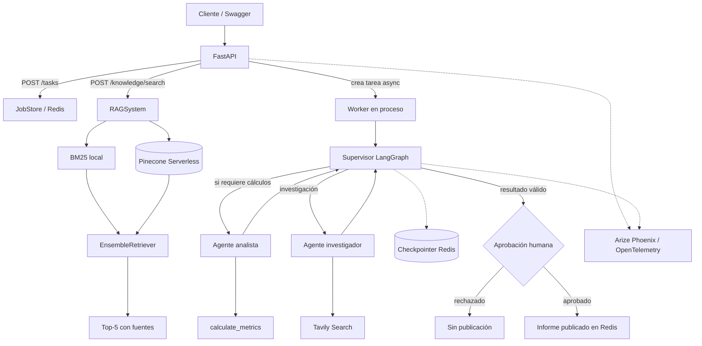
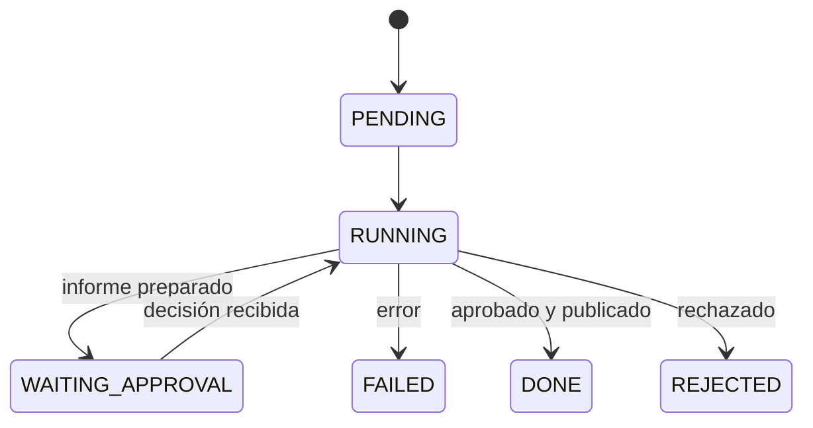
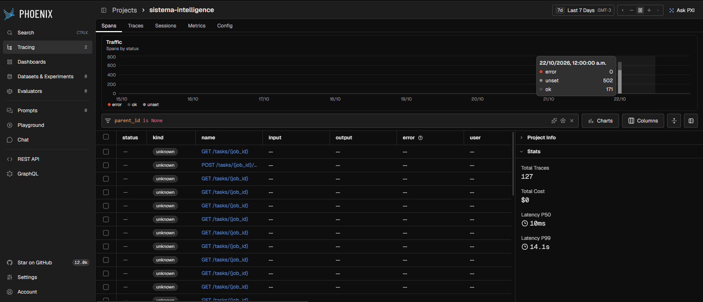
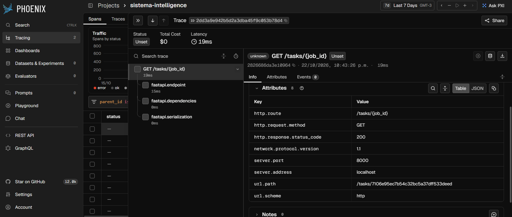
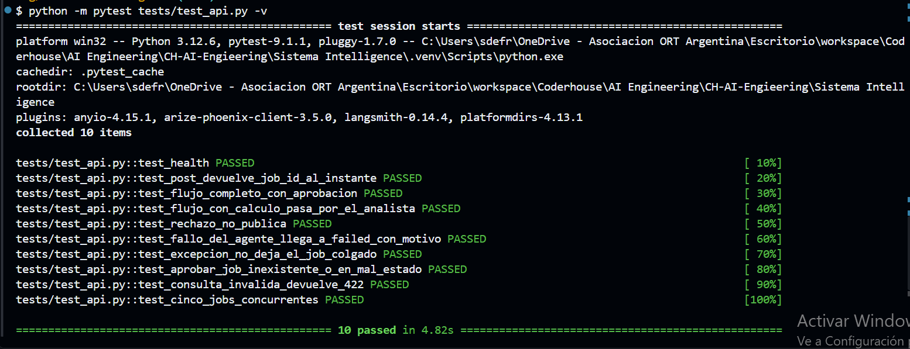

# Sistema Intelligence

**Plataforma de inteligencia artificial con recuperación aumentada (RAG), orquestación multiagente, API asíncrona, persistencia y observabilidad.**

Proyecto integrador del curso **AI Engineering de Coderhouse**, desarrollado en Python 3.12+ a partir de entregas incrementales. Reúne clientes de modelos de lenguaje, pipelines LangChain, un recuperador híbrido de documentación técnica, agentes LangGraph con Supervisor, una API FastAPI, Redis Stack y trazas en Arize Phoenix.

> **Alcance real de la integración:** una única API expone tanto los trabajos multiagente (`/tasks`) como la recuperación documental (`/knowledge/search`). Actualmente el Supervisor investiga mediante Tavily; **no selecciona automáticamente el RAG como herramienta**. El endpoint RAG recupera documentos y fuentes, pero no genera una respuesta con LLM.

## Contenido

1. [Qué hace el sistema](#qué-hace-el-sistema)
2. [Arquitectura](#arquitectura)
3. [Tecnologías y componentes](#tecnologías-y-componentes)
4. [Requisitos e instalación](#requisitos-e-instalación)
5. [Inicio local](#inicio-local)
6. [Uso de la API](#uso-de-la-api)
7. [RAG e indexación](#rag-e-indexación)
8. [Pruebas y resultados](#pruebas-y-resultados)
9. [Observabilidad y evidencias](#observabilidad-y-evidencias)
10. [Decisiones y limitaciones](#decisiones-y-limitaciones)
11. [Evolución académica](#evolución-académica)

## Qué hace el sistema

El proyecto ofrece dos flujos de trabajo complementarios:

- **Orquestación multiagente:** recibe una consulta, crea un trabajo asíncrono, investiga fuentes web con un agente especializado, realiza cálculos cuando corresponde y solicita aprobación humana antes de publicar un informe en Redis.
- **Consulta de conocimiento documental:** busca en documentación técnica indexada en Pinecone y en un recuperador BM25 local, fusiona los resultados y devuelve hasta cinco fragmentos con su procedencia.

La misma aplicación ofrece seguimiento de trabajos, validación mediante Pydantic y trazabilidad mediante Phoenix.

## Arquitectura



El Supervisor aplica controles deterministas sobre las decisiones propuestas por el modelo: evita bucles, limita reintentos y no deriva al analista si la consulta no necesita cálculos. El estado de ejecución de LangGraph se guarda mediante `AsyncRedisSaver`. Los trabajos de la API se almacenan por separado como JSON con TTL en Redis.

### Estados del trabajo



## Tecnologías y componentes

| Área | Tecnología | Implementación |
|---|---|---|
| Lenguaje y validación | Python 3.12+, Pydantic | `Config.py`, `schemas.py`, esquemas de API |
| Clientes LLM | OpenAI, Anthropic; Groq para agentes | `BaseLLMClient.py`, `models/`, `factory.py` |
| Pipelines | LangChain y LCEL | `chain.py`, `rag_chain.py` |
| Documentos | PDF/TXT, RecursiveCharacterTextSplitter | `ingest.py` |
| Embeddings | HuggingFace `all-MiniLM-L6-v2` | `factory.py` |
| Base vectorial | Pinecone Serverless | `vectorstore.py` |
| Recuperación híbrida | BM25 + Pinecone, `EnsembleRetriever` | `rag_chain.py` |
| Agentes | LangGraph, Tavily y herramientas de cálculo | `src/agents/`, `src/graph.py` |
| API | FastAPI + trabajo asíncrono en proceso | `app/main.py`, `app/worker.py` |
| Persistencia | Redis Stack + checkpoints Redis | `app/jobs.py`, `app/graph.py` |
| Aprobación humana | LangGraph `interrupt` / `Command(resume=...)` | `app/hitl.py` |
| Observabilidad | Arize Phoenix / OpenTelemetry | `app/observability.py` |
| Pruebas | pytest, fakeredis, TestClient | `tests/` |

### Organización del repositorio

```text
.
├── app/
│   ├── main.py              # API: tareas, aprobación, búsqueda RAG
│   ├── knowledge.py         # Recuperación documental asíncrona y esquemas
│   ├── graph.py             # Grafo de API + checkpointer Redis
│   ├── worker.py            # Ejecución y reanudación de trabajos
│   ├── jobs.py              # Estados y almacenamiento de jobs
│   ├── hitl.py              # Aprobación humana
│   └── observability.py     # Instrumentación Phoenix
├── src/
│   ├── agents/              # Supervisor, investigador y analista
│   ├── graph.py             # Orquestador multiagente
│   └── tools.py             # Tavily y cálculo de métricas
├── models/                  # Clientes de OpenAI y Anthropic
├── data/
│   ├── pathlib/             # Fichas técnicas para evaluación RAG
│   └── text.txt             # Datos heredados de módulos anteriores
├── tests/
│   ├── test_api.py
│   ├── test_rag_evaluation.py
│   └── test_knowledge_api.py
├── screenshots/             # Evidencias de Phoenix y pruebas de API
├── Config.py                # Configuración Pydantic
├── factory.py               # Fábrica de LLM y embeddings
├── ingest.py                # Carga y fragmentación
├── vectorstore.py           # Índice Pinecone
├── rag_chain.py             # RAGSystem + recuperación híbrida
├── evaluate.py              # Golden Set y Recall@5 / Precision@5
├── docker-compose.yml
├── run.sh                   # Inicio local en una instrucción
└── requirements.txt
```

## Requisitos e instalación

**Entorno:** Python 3.12 o posterior, Git, Docker Desktop/Engine con Docker Compose y Bash (Git Bash en Windows). Para ejecutar los agentes reales son necesarias credenciales de Groq y Tavily; para RAG es necesaria una cuenta de Pinecone.

Clonar y preparar un entorno virtual:

```bash
git clone https://github.com/leannmeier/CH-Project-AI-Engineering.git
cd CH-Project-AI-Engineering
python -m venv .venv
```

Activación del entorno:

- **Windows / Git Bash:** `source .venv/Scripts/activate`
- **Windows / PowerShell:** `.\.venv\Scripts\Activate.ps1`
- **Linux / macOS:** `source .venv/bin/activate`

Instalar dependencias y crear la configuración:

```bash
python -m pip install -r requirements.txt
cp .env.example .env
```

En Windows también podés copiar el archivo desde el explorador. **Nunca subas el archivo `.env` ni compartas las claves en capturas.**

### Variables de entorno

| Variable | Uso |
|---|---|
| `GROQ_API_KEY` | Modelo utilizado por Supervisor y agentes |
| `TAVILY_API_KEY` | Investigación web del agente |
| `PINECONE_API_KEY` | Índice vectorial |
| `INDEX_NAME` | Nombre del índice, por ejemplo `rag-entrega4-test` |
| `REDIS_URL` | Redis; valor local habitual `redis://localhost:6379/0` |
| `JOB_TTL_SECONDS` | Expiración de trabajos, por defecto 86400 segundos |
| `ENABLE_TRACING` | `1` para instrumentar, `0` para desactivar |
| `PHOENIX_COLLECTOR_ENDPOINT` | Destino del colector, localmente `http://localhost:6006` |
| `PHOENIX_PROJECT_NAME` | Proyecto de Phoenix: `sistema-intelligence` |
| `OPENAI_API_KEY`, `ANTHROPIC_API_KEY` | Opcionales para los clientes de módulos anteriores |

Las claves del ejemplo `.env.example` deben reemplazarse por credenciales válidas cuando corresponda.

## Inicio local

Una vez instaladas las dependencias y creado `.env`, el comando de arranque principal es:

```bash
bash run.sh
```

El script inicia **Redis Stack** con Docker Compose y después ejecuta FastAPI con Uvicorn. Disponible en:

- **Swagger UI:** http://127.0.0.1:8000/docs
- **OpenAPI:** http://127.0.0.1:8000/openapi.json
- **Health:** http://127.0.0.1:8000/health

Para observar las trazas en Phoenix, iniciar el servicio opcional **antes de lanzar la API**:

```bash
docker compose --profile observability up -d
bash run.sh
```

**Phoenix:** http://localhost:6006. Al probar servicios reales se recomienda `ENABLE_TRACING=1`.

> El inicio en una instrucción **presupone** que Python, dependencias, Docker y `.env` ya están preparados. `run.sh` no instala dependencias, no carga documentos en Pinecone y no levanta automáticamente Phoenix.

## Uso de la API

| Método | Endpoint | Descripción |
|---|---|---|
| `GET` | `/health` | Comprueba la disponibilidad de Redis |
| `POST` | `/tasks` | Crea un trabajo multiagente y devuelve `202` |
| `GET` | `/tasks/{job_id}` | Consulta el estado y resultado de un trabajo |
| `POST` | `/tasks/{job_id}/approve` | Aprueba o rechaza la publicación |
| `POST` | `/knowledge/search` | Devuelve fragmentos RAG con fuentes y metadatos |

### Caso 1 — Orquestación de agentes

En `POST /tasks`, desde Swagger o un cliente HTTP, enviar:

```json
{
  "query": "Buscá la población de Buenos Aires, Córdoba y Rosario y calculá el promedio."
}
```

El servidor responde `202 Accepted` y entrega un `job_id`. Luego consultar `GET /tasks/{job_id}`. Los estados contemplados son `PENDING`, `RUNNING`, `WAITING_APPROVAL`, `DONE`, `REJECTED` y `FAILED`.

Cuando el trabajo llega a `WAITING_APPROVAL`, llamar a `POST /tasks/{job_id}/approve`:

```json
{
  "approved": true,
  "comment": "Revisión de prueba"
}
```

La aprobación permite ejecutar la publicación **simulada** del informe en Redis (`report:{job_id}`). El rechazo deja el informe sin publicar. Un trabajo inexistente devuelve HTTP 404; aprobar fuera del estado esperado devuelve HTTP 409.

### Caso 2 — Consulta de documentación (RAG)

Enviar a `POST /knowledge/search`:

```json
{
  "question": "¿Cómo leer un archivo UTF-8 usando pathlib?",
  "k": 5
}
```

La respuesta incluye `question` y una lista `hits` de hasta cinco fragmentos; cada elemento informa `source`, `content` y `metadata`. Se valida que `question` tenga entre 3 y 500 caracteres y que `k` esté entre 1 y 5.

El resultado **no es una respuesta generada por un LLM**: proporciona contexto documental verificable. Si falla el acceso al recuperador, el endpoint devuelve HTTP 503.

## RAG e indexación

`ingest.py` carga archivos `.pdf` y `.txt` desde `data/` y subdirectorios. Los fragmenta usando `RecursiveCharacterTextSplitter` con tamaño de 800 caracteres y solapamiento de 150, conservando los metadatos de procedencia.

`vectorstore.py` utiliza el modelo local de embeddings `all-MiniLM-L6-v2` (**384 dimensiones**) e indexa los fragmentos en Pinecone Serverless. El recuperador híbrido asigna **40 % a BM25** y **60 % a Pinecone**. `RAGSystem` limita a cinco documentos el resultado después de la fusión. Se conserva `build_hybrid_retriever()` por compatibilidad.

En `data/pathlib/` hay cinco fichas técnicas **adaptadas y resumidas** de la [documentación oficial de Python](https://docs.python.org/3/library/pathlib.html), no copias literales. El antiguo `data/text.txt` se conserva como material legado.

### Crear un índice de prueba

Configurar en `.env`:

```dotenv
PINECONE_API_KEY=tu-clave-real
INDEX_NAME=rag-entrega4-test
```

Si ese índice ya contiene la documentación utilizada para la evaluación, **no es necesario reindexarlo**. Para un experimento limpio, usar otro nombre nuevo, compatible con el modelo de 384 dimensiones, y ejecutar:

```bash
python -c "from vectorstore import build_and_index_vectorstore; build_and_index_vectorstore()"
python evaluate.py
```

**Importante:** la indexación agrega vectores y no está diseñada como una sincronización idempotente ni borra documentos obsoletos. Evitar ejecutar cargas repetidas sobre un índice que se quiera preservar.

### Golden Set y métricas

`evaluate.py` evalúa cinco preguntas de `pathlib` con fuentes conocidas identificadas por `metadata["source"]`. Las preguntas cubren construcción de rutas, comprobaciones de archivos, lectura y escritura, búsqueda con glob y operaciones sobre directorios.

- **Recall@5:** proporción de *fuentes documentales esperadas* representadas entre los resultados recuperados.
- **Precision@5:** proporción de los cinco *chunks recuperados* que pertenecen a las fuentes esperadas. Varios chunks de una misma fuente cuentan por separado en precisión.

**Resultado de una ejecución real reportada el 31/10/2026**, con seis archivos cargados y once chunks:

| Métrica | Resultado |
|---|---:|
| Preguntas del Golden Set | 5 |
| Mean Recall@5 | **100 %** |
| Mean Precision@5 | **36 %** |
| Fuente esperada en primera posición | **5 de 5** |

Estas métricas reflejan recuperación y procedencia en un dataset acotado; **no equivalen a precisión semántica universal ni prueban respuestas generativas**.

## Pruebas y resultados

Para ejecutar todas las pruebas automatizadas:

```bash
python -m pytest tests/test_rag_evaluation.py tests/test_api.py tests/test_knowledge_api.py -v
```

**Resultado reportado el 31/10/2026 en Windows, Python 3.12.6:**

| Suite | Pruebas aprobadas |
|---|---:|
| `tests/test_rag_evaluation.py` | 7/7 |
| `tests/test_api.py` | 10/10 |
| `tests/test_knowledge_api.py` | 3/3 |
| **Total** | **20/20** |

Las pruebas automatizadas usan componentes simulados para Redis, agentes y recuperación documental. Además, se verificaron manualmente la indexación real en Pinecone y la respuesta HTTP `200 OK` de `POST /knowledge/search`. **No se afirma que estas 20 pruebas cubran todas las dependencias externas.**

Una comprobación de concurrencia real está disponible mediante:

```bash
python scripts/load_test.py -n 5 --stagger 2
```

Con límites del proveedor Groq, solicitudes concurrentes pueden recibir errores **429 Too Many Requests**. El sistema distingue fallos transitorios y permanentes; por eso una prueba de carga no garantiza que las cinco consultas concluyan con éxito si el proveedor limita el tráfico.

## Observabilidad y evidencias

`app/observability.py` configura instrumentación con Arize Phoenix y OpenTelemetry. El proyecto utiliza el nombre `sistema-intelligence`. La instrumentación permite registrar tráfico HTTP y, cuando está disponible, operaciones instrumentadas de LangChain/LangGraph.

### Capturas existentes

| Evidencia | Qué muestra |
|---|---|
| [evidencia-1.png](screenshots/evidencia-1.png) | Panel Phoenix del proyecto con **127 trazas** y solicitudes a endpoints de tareas |
| [evidencia-2.png](screenshots/evidencia-2.png) | Detalle de una traza `GET /tasks/{job_id}`, spans de FastAPI y HTTP 200 |
| [test-api.png](screenshots/test-api.png) | Ejecución anterior de diez pruebas de API aprobadas |







**Alcance de las evidencias:** estas imágenes acreditan que Phoenix estaba recibiendo trazas y que se ejecutaron pruebas de API. Por sí solas, **no prueban cinco recorridos completos y distintos** de Supervisor → herramientas → finalización; para sostener ese criterio de la evaluación final se necesitan trazas identificables de esos casos.

También existe una [demostración de los casos del orquestador](https://youtu.be/pGFE6rAPZFI) realizada durante la evolución del proyecto.

## Decisiones y limitaciones

1. **Orquestación controlada.** El Supervisor puede recibir propuestas del LLM, pero el programa valida las transiciones y limita iteraciones y reintentos. Los agentes investigadores usan Tavily; el analista puede invocar `calculate_metrics`.
2. **Async y validación.** FastAPI, las operaciones del grafo y el acceso a Redis emplean `async/await`. La inicialización del recuperador híbrido —que puede cargar embeddings y realizar E/S bloqueante— se deriva a `asyncio.to_thread`. Pydantic valida contratos de entrada y salida.
3. **Persistencia de estado.** Los checkpoints de LangGraph viven en Redis. Sin embargo, el worker se implementa mediante `asyncio.create_task` dentro del proceso de FastAPI: **no existe recuperación automática garantizada de los trabajos en curso tras reiniciar el proceso**.
4. **Human-in-the-loop.** El grafo usa `interrupt()` y se reanuda con `Command(resume=...)`. La publicación del informe es una acción simulada mediante escritura en Redis.
5. **Separación de funciones.** El endpoint RAG usa BM25 + Pinecone, mientras que el Supervisor usa Tavily. La selección automática entre ambas fuentes **no está implementada**.
6. **Dependencias.** El archivo `requirements.txt` contiene versiones fijadas; el funcionamiento en Python 3.12.6 está respaldado por pruebas de un entorno existente, pero **la instalación desde cero en un entorno limpio todavía debe validarse**.
7. **Migraciones de librerías.** El uso de `BM25Retriever` desde `langchain-community` emite una advertencia de deprecación. No impide las ejecuciones reportadas, pero debe revisarse en futuras actualizaciones.
8. **Operación local.** `run.sh` simplifica el arranque, pero no sustituye la instalación inicial de Docker, Python ni credenciales. CI/CD y despliegue cloud no forman parte de esta implementación.

## Evolución académica

Este repositorio conserva los componentes de las entregas previas y los integra progresivamente:

- **Módulos 1–2:** clientes asíncronos de OpenAI y Anthropic, configuración y salida estructurada con LCEL.
- **Módulos 3–4:** ingesta, fragmentación, RAG híbrido y evaluación por fuente documental en Pinecone.
- **Módulo 5:** experimentación con agentes y persistencia SQLite en etapas anteriores. Algunas interfaces históricas permanecen en el repositorio; **la aplicación actual utiliza el Supervisor de `src/graph.py` y `app/graph.py`**, no el flujo antiguo de dos nodos.
- **Módulo 6:** Supervisor con agentes especializados de investigación y análisis.
- **Módulo 7:** FastAPI, Redis Stack, human-in-the-loop, observabilidad y pruebas.
- **Entrega final:** exposición del recuperador RAG en la misma API, arranque local simplificado y documentación integrada.

## Autor

**Leandro Agustín Meier** — Analista de Sistemas.

Proyecto académico de **AI Engineering — Coderhouse**.
