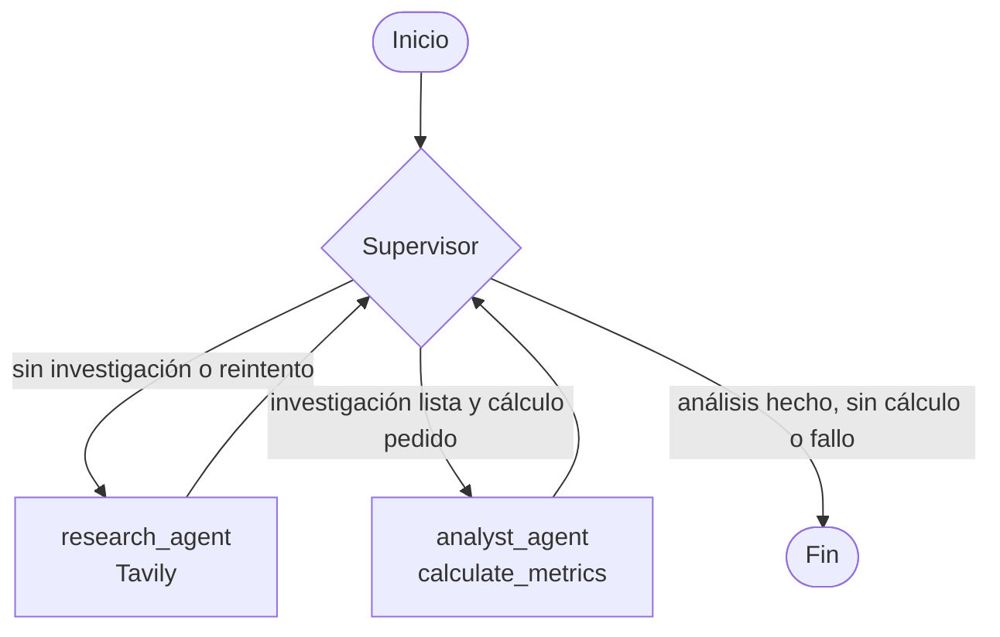
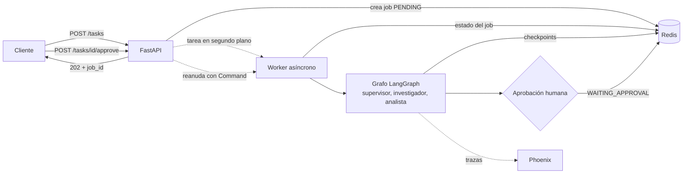
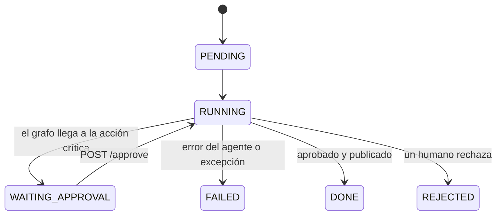

# Sistema Intelligence — Unified Async LLM Client

Cliente asíncrono unificado para interactuar con múltiples proveedores de LLM (Anthropic y OpenAI) bajo una única interfaz común, con validación de datos vía Pydantic, soporte de streaming, pipelines LCEL con salida estructurada/resiliente, y un sistema RAG avanzado escalable en Pinecone con recuperación híbrida.

## Arquitectura

### Módulo 1 — Cliente async unificado
- **`BaseLLMClient`** — clase abstracta (ABC) que define el contrato común: `generate_response` (respuesta completa) y `generate_response_stream` (generador asíncrono de tokens).
- **`AnthropicClient`** / **`OpenAIClient`** (en `models/`) — implementaciones concretas del contrato, cada una traduciendo el formato específico de su SDK a los esquemas propios del proyecto.
- **`schemas.py`** — modelos Pydantic del proyecto (`ChatMessage`, `ModelResponse`/`Usage`, `FinishReason`, `AnalisisTecnico`).
- **`Config.py`** — configuración validada con Pydantic (proveedor, modelo, API key protegida con `SecretStr`, temperatura 0-2, `max_tokens` ≥ 1).
- **`exceptions.py`** — `LLMClientError`, excepción propia que envuelve los errores específicos de cada SDK bajo un solo tipo genérico.
- **`factory.py`** — `LLMFactory`, resuelve el cliente LLM (`ChatOpenAI`/`ChatAnthropic`) y el modelo de embeddings correctos a partir de `Config.provider`.

### Módulo 2 — Pipeline LCEL con salida estructurada
- **`chain.py`** — pipeline (`prompt | llm.with_structured_output(AnalisisTecnico)`) que analiza un texto libre y devuelve un objeto validado (tecnologías, criticidad, resumen). Incluye reintentos automáticos con backoff exponencial (`with_retry`) ante fallos transitorios.

### Módulo 3 — RAG local con ChromaDB
- **`ingest.py`** — carga documentos (`.pdf`/`.txt`, UTF-8) desde `./data` y los fragmenta con `RecursiveCharacterTextSplitter` (chunk_size=800, overlap=150), preservando metadata de origen.
- Pipeline RAG local inicial sobre ChromaDB, luego migrado a Pinecone en el Módulo 4 (ver abajo).

### Módulo 4 — RAG avanzado y escalable con Pinecone
- **`vectorstore.py`** — migrado de ChromaDB local a **Pinecone Serverless** (`PineconeVectorStore`). Crea el índice automáticamente si no existe, con dimensión ajustada al modelo de embeddings local (`all-MiniLM-L6-v2`, 384 dimensiones) y métrica coseno. Sigue usando embeddings locales de HuggingFace para no depender de crédito de API.
- **`rag_chain.py`** — `build_hybrid_retriever` combina un retriever **vectorial** (Pinecone) con un retriever **léxico** (`BM25Retriever`, local) mediante `EnsembleRetriever` (ponderación 60% vectorial / 40% léxico), para cubrir tanto similitud semántica como coincidencias exactas de términos.
- **`evaluate.py`** — script de evaluación cuantitativa: ejecuta el recuperador híbrido contra un "Golden Set" de preguntas con una palabra clave esperada, y calcula **Precision@5** y **Recall@5** por pregunta y en promedio. No depende de ningún LLM (solo recuperación), así que corre sin necesidad de crédito de OpenAI/Anthropic.
- **`main.py`** — con el flag `--evaluate` corre `evaluate.py` en lugar del flujo normal de consulta RAG.

### Módulo 5 — Agente de razonamiento cíclico con LangGraph

- **`src/graph.py`** — define el `StateGraph` (sobre `MessagesState`) con dos nodos: `agent` (invoca al LLM con las herramientas disponibles) y `tools` (`ToolNode` que ejecuta la herramienta elegida). Las aristas condicionales (`tools_condition`) deciden si el flujo vuelve a `tools` o termina, implementando el ciclo ReAct (razonar → actuar → observar → repetir). Expone `get_agent_executor()` como única fuente de verdad para compilar el grafo con un checkpointer.
- **`src/tools.py`** — herramientas del agente: `buscar_cliente_por_email` y `obtener_pedidos_cliente` (datos mock de gestión de clientes), y `consultar_base_conocimiento` (reutiliza el recuperador híbrido del Módulo 4 para responder preguntas sobre la documentación indexada).
- **`src/agent.py`** — `run_agent(query, thread_id)`, punto de entrada reutilizable que ejecuta una consulta sobre el grafo persistiendo el estado en SQLite (`AsyncSqliteSaver`) bajo el `thread_id` dado, con un límite de recursión para evitar loops infinitos.
- **`main.py`** — demuestra el agente en dos turnos sobre el mismo `thread_id`: el primero dispara una cadena de 2 llamadas a herramientas (ReAct multi-paso), el segundo consulta sobre información mencionada en el turno anterior para verificar la persistencia real de memoria. Registra la traza de ejecución (`execution_trace.json`) usando `astream_events`.

**Nota:** el LLM del agente usa Groq (`openai/gpt-oss-20b`) a través de `LLMFactory`/`Config`, agregado como proveedor adicional junto a OpenAI/Anthropic para evitar los bloqueos de crédito de esas dos cuentas durante el desarrollo.

### Módulo 6 — Orquestador multi-agente con supervisor

Sistema de tres nodos sobre LangGraph: un **supervisor** que decide el flujo y dos **agentes especializados** (investigación y análisis), con un estado compartido y persistencia en SQLite.

#### Diagrama del grafo



#### Componentes

- **`state.py`** — `MultiAgentState`: mensajes, `next_agent`, `iteration_count`/`max_iterations`, `retry_count`, `research_data` (acumulativo, registra qué agente aportó qué), `analysis_result` y `task_status`.
- **`src/agents/supervisor.py`** — decide el siguiente paso. El LLM propone con salida estructurada (`SupervisorOutput`, con `Literal` para los destinos) y el código valida la propuesta.
- **`src/agents/research_agent.py`** — agente con Tavily. Conserva solo título, URL y contenido de cada resultado, tiene un límite de pasos propio y marca error si no obtuvo fuentes útiles. Distingue errores pasajeros (límite de uso, 429) de los definitivos.
- **`src/agents/analyst_agent.py`** — agente con `calculate_metrics`. Solo marca éxito si la herramienta devolvió métricas válidas, y cita año y fuente de cada cifra.
- **`src/graph.py`** — aristas condicionales con tipo de retorno `Literal` y una guarda adicional.
- **`main.py`** — ejecuta los casos de prueba: `python main.py --case 1|2|3` (sin argumento corre los tres).

#### Por qué una topología jerárquica

El flujo depende de la pregunta: una consulta informativa termina tras investigar y una que pide cálculos pasa además por el analista. Un supervisor central permite auditar cada decisión (cada una se imprime con su razón) y aplicar límites en un solo lugar. El costo es que el supervisor es un punto único de falla, que se mitiga con las guardas descritas abajo.

#### Manejo de conflictos y bucles

- Tope de iteraciones (`max_iterations`) y límite de pasos propio en cada agente.
- No se repite la investigación si ya fue exitosa.
- No se deriva al analista si el usuario no pidió un cálculo, y no se cierra sin análisis si se pidió.
- Un único reintento, solo para errores pasajeros. Los errores definitivos cierran con `failed` y el motivo real.
- El cierre posterior al análisis se decide en código, sin llamar al modelo.

#### Decisiones y compromisos

- **El LLM propone, el código valida.** Se usa el modelo para entender la intención y reglas deterministas para impedir movimientos ilegales.
- **Detección de cálculo por palabras clave** ("calcula", "promedio", "total", "suma", "métrica"). Es simple y predecible, pero no reconoce paráfrasis como "la media".
- **Modelo:** `openai/gpt-oss-20b` servido por Groq, porque las cuentas de OpenAI y Anthropic no tenían crédito. Por los límites de tokens del plan gratuito, se acotan los resultados de búsqueda (`max_results=3`, truncado por fuente).
- **Calidad de los datos:** las cifras provienen de búsquedas web y pueden mezclar años o fuentes. El sistema las cita pero no las verifica.

#### Casos de prueba

1. Consulta informativa sin cálculo: investiga y cierra.
2. Búsqueda con cálculo ("población de Buenos Aires, Córdoba y Rosario y su promedio"): investiga, analiza y cierra.
3. Consulta sin datos disponibles: falla de forma controlada con el motivo real.

Demostración en video: [Casos de prueba](https://youtu.be/pGFE6rAPZFI)

### Módulo 7 — API de producción con FastAPI, Redis y observabilidad

El sistema multi-agente del Módulo 6 queda expuesto como una API asíncrona: una consulta se encola, se ejecuta en segundo plano y su estado se consulta por `job_id`. Antes de la acción crítica (publicar el reporte) el grafo se pausa y espera la aprobación de una persona.

#### Arquitectura



#### Estados de un job



#### Estructura

- `app/main.py` — la API: encolado, consulta de estado y aprobación. Abre Redis y el checkpointer una sola vez al arrancar (lifespan).
- `app/jobs.py` — modelo `Job` (Pydantic) y almacén de jobs en Redis con cliente asíncrono y TTL.
- `app/worker.py` — ejecuta y reanuda el grafo en segundo plano. Toda excepción termina en `FAILED` con el motivo y su tipo (pasajero o definitivo).
- `app/graph.py` — el orquestador del Módulo 6 más el nodo de aprobación humana, con el checkpointer de Redis (`AsyncRedisSaver`).
- `app/hitl.py` — nodo Human-in-the-loop (`interrupt`) y la acción crítica simulada.
- `app/observability.py` — trazas con Arize Phoenix (local).
- `scripts/load_test.py` — prueba de 5 peticiones concurrentes.
- `tests/test_api.py` — tests de la API con Redis simulado y nodos falsos.
- `docker-compose.yml` — Redis Stack (y Phoenix como perfil opcional).
- `screenshots/` — capturas de las trazas.

#### Cómo correrlo

1. Levantar Redis (necesita RedisJSON y RediSearch, por eso se usa Redis Stack):
   ```bash
   docker compose up -d
   ```
2. Opcional, para ver las trazas: `docker compose --profile observability up -d` o `pip install arize-phoenix && phoenix serve`. La interfaz queda en http://localhost:6006.
3. Instalar dependencias y configurar `.env` (ver `.env.example`):
   ```bash
   pip install -r requirements.txt
   ```
4. Arrancar la API desde la raíz del repo:
   ```bash
   uvicorn app.main:app --port 8000
   ```
5. Probar el flujo completo:
   ```bash
   # encolar (responde al instante con el job_id)
   curl -X POST http://localhost:8000/tasks -H "Content-Type: application/json" \
        -d '{"query": "Buscá la población de Buenos Aires, Córdoba y Rosario y calculá el promedio."}'

   # consultar el estado (cuando llega a WAITING_APPROVAL trae el borrador a aprobar)
   curl http://localhost:8000/tasks/<job_id>

   # aprobar o rechazar la publicación del reporte
   curl -X POST http://localhost:8000/tasks/<job_id>/approve -H "Content-Type: application/json" \
        -d '{"approved": true, "comment": "ok"}'
   ```
6. Prueba de concurrencia y tests:
   ```bash
   python scripts/load_test.py --approve
   pytest tests/test_api.py -v
   ```

#### Manejo de fallos

| Situación | Resultado |
|---|---|
| El agente no encuentra resultados | `FAILED`, con el motivo en `error` y `error_type: permanent` |
| Límite de uso del proveedor (429) | `FAILED`, con `error_type: transient` |
| Excepción inesperada en el grafo | `FAILED`, con el nombre y mensaje de la excepción |
| Aprobar un job que no espera aprobación | `409` |
| Job inexistente o expirado | `404` |
| Redis caído al arrancar | la API falla al iniciar con un mensaje claro |

#### Decisiones y límites

- **Worker dentro del proceso de la API.** La consigna acepta una tarea asíncrona simple. Si el proceso se cae con un job en ejecución, el job queda en `RUNNING` hasta que expira, aunque sus checkpoints siguen en Redis. Un worker separado con cola real (por ejemplo, Redis Streams o Celery) sería el siguiente paso.
- **Acción crítica simulada.** "Publicar" guarda el reporte en Redis (`report:<job_id>`). La aprobación humana es lo que se está demostrando.
- **Límites de Groq.** Con el plan gratuito, varias corridas simultáneas del sistema multi-agente pueden recibir 429. Esos jobs terminan en `FAILED` con `error_type: transient`.
- **TTL.** Los jobs expiran a las 24 horas (`JOB_TTL_SECONDS`).

#### Evidencia de observabilidad

Capturas de las trazas de Phoenix en `screenshots/`: una ejecución completa (supervisor, investigador, analista) y la prueba de 5 peticiones concurrentes con sus latencias.

#### Verificación

Qué se probó automáticamente y qué se verifica a mano:

- **Automático (`pytest`):** estados del job, pausa y reanudación con aprobación, rechazo, fallos que llegan a `FAILED`, errores 404/409/422 y 5 jobs concurrentes, usando Redis simulado y nodos falsos.
- **A mano:** Redis Stack real con el checkpointer, las trazas en Phoenix y el sistema completo con los modelos reales.

## Requisitos

- Python 3.12
- Docker Desktop (para Redis Stack en el Módulo 7)
- Claves de API:
  - **Groq** y **Tavily**: agentes de los Módulos 5 a 7 y búsqueda web del investigador.
  - **Pinecone** (plan gratuito): índice vectorial del Módulo 4.
  - **OpenAI** y/o **Anthropic** (opcionales, con crédito cargado): clientes de los Módulos 1 y 2.


## Instalación

```bash
# Crear y activar entorno virtual
python -m venv .venv
source .venv/Scripts/activate   # Git Bash / Linux / Mac
# .venv\Scripts\activate.bat    # cmd de Windows

# Instalar dependencias
pip install -r requirements.txt
```

## Configuración

Copiá `.env.example` a `.env` y completá tus claves reales (el archivo `.env` está en `.gitignore` y nunca se sube al repositorio):

```bash
cp .env.example .env
```

| Variable | Módulos | Para qué se usa |
|---|---|---|
| `ANTHROPIC_API_KEY`, `OPENAI_API_KEY` | 1, 2 | Clientes y pipeline con salida estructurada |
| `GROQ_API_KEY` | 5, 6, 7 | Modelo de los agentes (`openai/gpt-oss-20b` servido por Groq) |
| `TAVILY_API_KEY` | 6, 7 | Búsqueda web del agente investigador |
| `PINECONE_API_KEY`, `INDEX_NAME` | 4 | Índice vectorial en la nube |
| `REDIS_URL`, `JOB_TTL_SECONDS` | 7 | Redis Stack y duración de los jobs |
| `ENABLE_TRACING`, `PHOENIX_COLLECTOR_ENDPOINT`, `PHOENIX_PROJECT_NAME` | 7 | Trazas con Phoenix (`ENABLE_TRACING=0` si no está corriendo) |

## Uso

Cada módulo se ejecuta por separado, desde la raíz del repo y con el entorno virtual activado.

**Módulo 4 — RAG híbrido** (necesita `PINECONE_API_KEY` y documentos `.pdf` o `.txt` en UTF-8 dentro de `./data`):

```bash
# indexar los documentos en Pinecone (una sola vez)
python -c "from vectorstore import build_and_index_vectorstore; build_and_index_vectorstore()"

# evaluación cuantitativa (Precision@5 y Recall@5, no necesita crédito de LLM)
python evaluate.py
```

**Módulo 6 — Orquestador multi-agente** (necesita `GROQ_API_KEY` y `TAVILY_API_KEY`):

```bash
python main.py --case 1   # también 2 o 3; sin argumento corre los tres casos
```

**Módulo 7 — API de producción:** ver "Cómo correrlo" en la sección del Módulo 7.

Si cambiás el contenido de `./data`, hace falta reindexar: usá un `INDEX_NAME` nuevo o vaciá el índice desde el panel de Pinecone.

## Notas de implementación

- **Anthropic (SDK ≥ 1.0):** el SDK crudo (`anthropic`) eliminó `temperature` de `messages.create()`; el `AnthropicClient` del Módulo 1 no lo reenvía por este motivo. El wrapper de LangChain (`langchain_anthropic.ChatAnthropic`) sí lo acepta y lo maneja internamente sin ese conflicto.
- **Manejo de errores:** ambos clientes del Módulo 1 capturan la excepción base de su SDK y la traducen a `LLMClientError`, agnóstica de proveedor.
- **Resiliencia (Módulo 2):** el pipeline LCEL reintenta automáticamente (hasta 3 intentos, con backoff exponencial) ante errores transitorios.
- **Embeddings locales:** se usa `HuggingFaceEmbeddings` (`all-MiniLM-L6-v2`, 384 dimensiones) en lugar de embeddings de OpenAI/Anthropic, para que la indexación y recuperación funcionen sin consumir crédito de API — solo la generación final de texto depende del proveedor LLM configurado.
- **LangChain ≥ 1.0:** la reorganización del paquete movió componentes "clásicos" (como `EnsembleRetriever`) a `langchain-classic`, separado del núcleo `langchain` (enfocado ahora en agentes). Ver `requirements.txt` para las dependencias exactas instaladas.
- **Dimensión del índice de Pinecone:** debe coincidir con la dimensión del modelo de embeddings usado (384 para `all-MiniLM-L6-v2`), no con la de modelos de OpenAI (1536) si no se usan esos embeddings.

## Autor
Meier Leandro Agustín — Analista de Sistemas